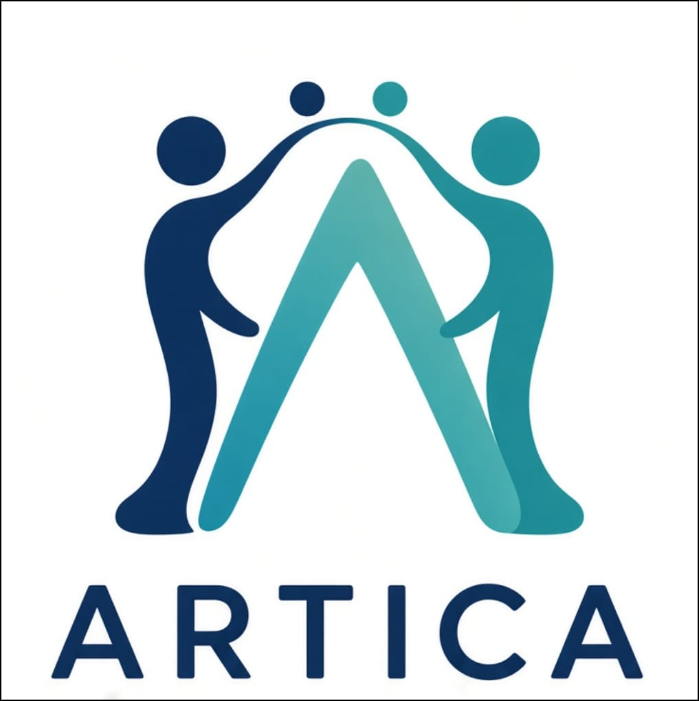

# ARTICA · Logística humanitaria y trazabilidad de donaciones

Se presenta un sistema web para la trazabilidad logística de donaciones y ayuda humanitaria distribuida a contingencias y necesidades sociales regionales en Venezuela. La propuesta es fundamental en las iniciativas de plataforma digital de respuesta humanitaria y gestión social al contexto nacional, inspirada en modelos y antecedentes de SOS Yummy y el trabajo de Arenas E.R. con Donavenezuela.com. Un enfoque ambientalmente aplicado se basa en la loable metodología Scrum, un desarrollo fragmentado y modular por componentes. La arquitectura del sistema es con Coruña como Angular para el frontend y Visual Studio Code, completando el ciclo de desarrollo en menos de un mes. La aplicación de una plataforma web lleva a cabo el seguimiento en tiempo real de los centros de acopio (inventario disponible y áreas personales), condiciones y la logística del transporte de entrada. Para la integración de API de mapas (Google Maps / OpenStreetMap), la plataforma personal georreferencia el origen, la ruta en el camino y el destino de los Congresos, dominando la trazabilidad y la importancia de las donaciones.

Este sistema usa Angular 22 + TypeScript + CSS (página estática), API en funciones pruebas de Vercel (Express) una base de
base de datos PostgreSQL en la nube (Neon) y un sistema para almacenamiento fotos en Vercel Blob y un sistema de geolocalización y mapeado con tecnología de terceros de OpenStreetMap.

Se puede trabajar en local con los comandos:

(bash)
cd [dirección de código] npm serve
npm start     http://localhost:4200

 El proyecto está en desarrollo pero puede probarlo ingresando a enlace de Vercel